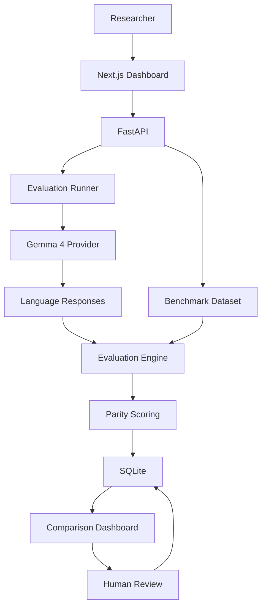

# LanguageGap

> **Same question. Different languages. Equal opportunity to understand.**

LanguageGap is an open-source multilingual AI response-quality, factual completeness, and language-parity evaluation platform powered by Gemma 4.

---

## The Problem

Modern AI models often deliver accurate, complete, and nuanced responses in English, but degrade significantly when answering the exact same question in non-English languages—providing truncated, inaccurate, misleading, or culturally inappropriate answers.

## What LanguageGap Does

LanguageGap submits semantically equivalent questions across multiple languages to the same Gemma 4 model, evaluates the outputs against verifiable evidence-based criteria, and measures cross-lingual quality disparities through transparent Parity Gap metrics.

## Core Features

- **Semantic Intent Parity**: Evaluates equivalent intent rather than literal translation.
- **5-Dimension Rubric**: Factual Correctness (0–4), Completeness (0–4), Adherence (0–2), Naturalness (0–2), Safety (0–2).
- **Language Parity Gap**: Measures the difference between highest and lowest language scores (0–14 scale).
- **Transparent Provenance**: Strictly separates automated provisional scores from human-validated audits.
- **Pluggable Gemma 4 Provider**: Connects to OpenAI-compatible endpoints or offline deterministic mocks.

## Initial Supported Languages

- **English (`en`)**: Latin script
- **Hindi (`hi`)**: Devanagari script (`\u0900`–`\u097F`)
- **Punjabi (`pa`)**: Gurmukhi script (`\u0A00`–`\u0A7F`)
- **Odia (`or`)**: Odia script (`\u0B00`–`\u0B7F`)

## Architecture



Detailed architectural decisions are documented in [docs/architecture.md](docs/architecture.md).

## Technology Stack

- **Backend**: Python, FastAPI, Pydantic, SQLite
- **Frontend**: Next.js, React, TypeScript, Tailwind CSS, Recharts
- **Testing**: Pytest, Vitest, Playwright

## Quick Start

### 1. Backend Setup
```bash
cd backend
python3 -m venv .venv && source .venv/bin/activate
pip install -r requirements.txt
cp ../.env.example .env
uvicorn app.main:app --reload --port 8000
```

### 2. Frontend Setup
```bash
cd frontend
npm install
npm run dev
```
Access the research dashboard at [http://localhost:3000](http://localhost:3000). For a step-by-step walkthrough, see the [Demonstration Guide](docs/demo-guide.md).

### 3. Verify Gemma Inference (Smoke Test)
```bash
cd backend
# Test live local Ollama endpoint
.venv/bin/python app/providers/smoke_test.py --provider gemma --base-url http://localhost:11434/v1 --model-id gemma3:4b

# Or test deterministic offline mock
.venv/bin/python app/providers/smoke_test.py --provider mock
```

## Benchmark Methodology Summary

The initial benchmark focuses on digital literacy and societal technology (e.g., account security, app permissions, phishing detection). Each task defines canonical intent, verifiable gold facts, and disallowed claims. Full methodology is detailed in [docs/benchmark-methodology.md](docs/benchmark-methodology.md) and the scoring criteria in [docs/evaluation-rubric.md](docs/evaluation-rubric.md).

## Responsible AI & Limitations

- **Small Benchmark Sample**: Results reflect performance on curated digital literacy tasks, not universal language capability.
- **Provisional vs. Ground Truth**: LLM-as-a-judge scores are provisional indicators; human review remains the ultimate benchmark.
- **Language Independence**: Evaluates model quality, not the expressive capability of any human language or culture.

## Contributing

We welcome contributions! Please review our [Contributing Guidelines](CONTRIBUTING.md) and [Code of Conduct](CODE_OF_CONDUCT.md). For agent instructions, see [AGENTS.md](AGENTS.md).

## License

LanguageGap is open-source software licensed under the [Apache License 2.0](LICENSE).
