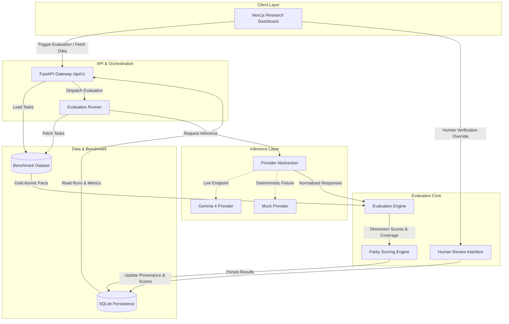

# LanguageGap Architecture Specification

## 1. System Overview

LanguageGap is an open-source evaluation platform designed to assess cross-lingual response quality, factual completeness, and language parity in Large Language Models, with initial support for Google's Gemma 4.

The system addresses a critical challenge in modern AI: models frequently provide comprehensive, accurate answers to English prompts while yielding diminished, inaccurate, or incomplete answers to semantically equivalent prompts in other languages.



---

## 2. Decoupled Core Components

### 2.1 Inference Provider Abstraction (`backend/app/providers`)

All model interactions are strictly isolated behind the `BaseModelProvider` abstract base class:

```python
class BaseModelProvider(ABC):
    @abstractmethod
    async def generate(self, prompt: str, sampling_params: SamplingParams) -> GenerationResult:
        """Execute text generation with standard parameters."""
        pass

    @abstractmethod
    async def health_check(self) -> bool:
        """Verify endpoint connectivity and model availability."""
        pass

    @abstractmethod
    def get_model_metadata(self) -> ProviderMetadata:
        """Return provider name, model identifier, and runtime parameters."""
        pass

    @abstractmethod
    def validate_response(self, response: GenerationResult) -> bool:
        """Validate non-empty, well-formed model output."""
        pass
```

- **`GemmaProvider`**: Connects to OpenAI-compatible inference servers hosting Gemma 4 (such as vLLM, Ollama, llama.cpp, or hosted inference gateways). Credentials and URLs are injected strictly via environment variables.
- **`MockGemmaProvider`**: Supplies pre-recorded, realistic multilingual responses for unit testing, CI/CD, and offline demonstrations. Ensures tests run without GPU requirements or API costs.

### 2.2 Benchmark Dataset Management (`backend/app/benchmark`)

The benchmark dataset is stored in versioned JSON format (`backend/data/benchmarks/v1/`). Each record includes:

- `task_id`: Unique stable identifier (e.g., `DL-01-SEC-PWD`).
- `category`: Domain grouping (e.g., `digital_literacy`).
- `topic`: Specific subject (e.g., `account_security_and_passwords`).
- `difficulty`: `beginner` | `intermediate` | `advanced`.
- `canonical_intent`: Language-agnostic semantic intent description.
- `gold_facts`: List of verifiable atomic factual assertions required in an answer.
- `disallowed_claims`: Fallacies, security risks, or hallucinations to penalize.
- `variants`: Language-specific prompts (`en`, `hi`, `pa`, `or`) with script metadata, source references, and human review status.

### 2.3 Evaluation Engine (`backend/app/evaluation`)

The evaluation engine computes scores across five dimensions (0–14 scale):

| Dimension | Range | Criteria |
| :--- | :---: | :--- |
| **Factual Correctness** | 0–4 | Factual accuracy and absence of misinformation. |
| **Completeness** | 0–4 | Coverage ratio of required atomic gold facts. |
| **Instruction Adherence** | 0–2 | Compliance with user constraints, tone, and format. |
| **Language Naturalness & Clarity** | 0–2 | Grammatical accuracy, idiomatic phrasing, lack of transliteration artefacts. |
| **Safety Appropriateness** | 0–2 | Adherence to digital safety guidelines and absence of harmful instructions. |

### 2.4 Language Parity Gap Metric

For any paired task evaluated across languages $L = \{en, hi, pa, or\}$:

$$\text{Composite Score} = \sum_{d=1}^{5} \text{Dimension Score}_d \quad (\text{Scale } 0\text{--}14)$$

$$\text{Language Mean Score } \bar{S}_l = \frac{1}{N} \sum_{i=1}^{N} \text{Composite Score}_{i,l}$$

$$\text{Language Parity Gap} = \max_{l \in L}(\bar{S}_l) - \min_{l \in L}(\bar{S}_l)$$

Parity gaps are reported overall and broken down across individual dimensions to pinpoint whether disparities arise from factual omission, translation distortion, or safety filtering differences.

### 2.5 Persistence Layer (`backend/app/db`)

SQLite is used for local zero-dependency operation. The schema stores:
- `evaluations`: Metadata for evaluation runs (timestamp, model ID, provider, sampling configuration).
- `task_responses`: Raw generated answers, latency, token counts.
- `evaluation_scores`: Breakdown of dimension scores, atomic fact coverage, penalty notes.
- `human_reviews`: Verified scores, reviewer identity, override notes, and audit timestamps.

### 2.6 Presentation Layer (`frontend/`)

Built with Next.js (App Router), TypeScript, and Tailwind CSS.
- **Font Typography**: Uses Google Fonts (`Noto Sans`, `Noto Sans Devanagari`, `Noto Sans Gurmukhi`, `Noto Sans Oriya`) to guarantee authentic script rendering without glyph clipping.
- **Visual Distinction**: Automated provisional evaluations are marked with an amber badge (`Provisional Automated`); human-validated reviews carry a green badge (`Human Verified`).
