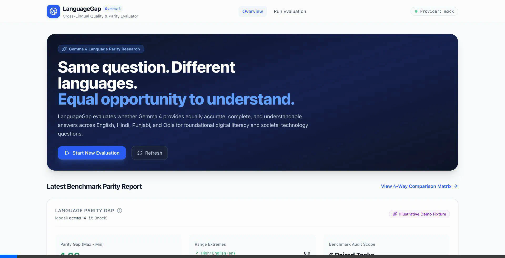
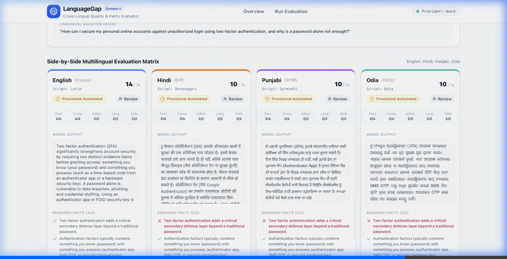
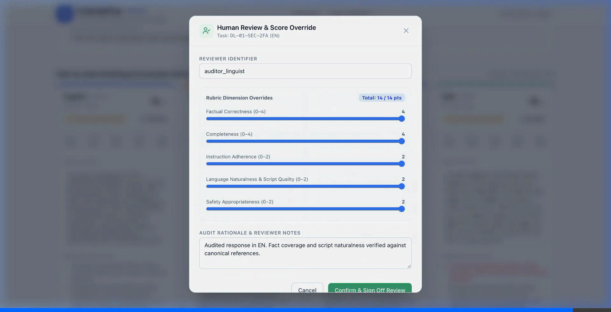

# LanguageGap Demonstration Guide

> **A reproducible, verifiable demonstration of multilingual AI quality and parity evaluation across English, Hindi, Punjabi, and Odia.**

This guide provides evaluators, researchers, and hackathon judges with a reproducible walkthrough of the LanguageGap platform. It covers environment setup, live Gemma inference verification, deterministic offline fixture execution, a concise 5-minute evaluation script, visual walkthrough screenshots, architecture and methodology summaries, system limitations, and open-source contribution opportunities.

---

## 1. Quick Local Execution

### Prerequisites
- **Python**: 3.10+ (tested on Python 3.14)
- **Node.js**: 18+ (tested on Node.js 25)
- **Git**

### Step 1: Start Backend (Terminal 1)
```bash
cd backend
python3 -m venv .venv
source .venv/bin/activate
pip install -r requirements.txt
cp ../.env.example .env
uvicorn app.main:app --reload --port 8000
```
*Health check*: verify that `http://localhost:8000/api/v1/health` returns `{"status": "ok"}`.

### Step 2: Start Frontend (Terminal 2)
```bash
cd frontend
npm install
npm run dev
```
Open [http://localhost:3000](http://localhost:3000) in your web browser.

---

## 2. Live Gemma Inference vs. Illustrative Fixture Fallback

LanguageGap provides two distinct execution paths to ensure complete transparency, zero fabrication, and guaranteed reproducibility:

### Mode A: Deterministic Illustrative Fixture Fallback (`mock` provider)
- **Zero Cost & Instant Latency**: Runs all 6 paired benchmark tasks (24 total responses) across English, Hindi, Punjabi, and Odia in < 1 second.
- **Deterministic Baseline**: Built using realistic, linguistically authentic Indic responses to illustrate the exact parity gap dynamics without requiring an active GPU or paid API keys.
- **Transparent Labelling**: Every run created with this provider is prominently flagged with an **"Illustrative Demo Fixture"** badge across the dashboard, matrix cards, and evaluation report.

### Mode B: Live Gemma Provider (`gemma` provider)
- **Real Inference**: Connects to any OpenAI-compatible Gemma 4 inference server (such as Ollama, vLLM, Google AI Studio, or OpenRouter).
- **Backend Secrets**: API credentials (`GEMMA_API_KEY`, `GEMMA_BASE_URL`) remain securely on the backend server and are never exposed to the client browser.

### Verifying Live Gemma Inference with `smoke_test.py`
Before initiating large evaluations, verify your live Gemma inference endpoint using our built-in provider smoke test:

```bash
cd backend
# Probe local Ollama or vLLM endpoint
.venv/bin/python app/providers/smoke_test.py --provider gemma --base-url http://localhost:11434/v1 --model-id gemma3:4b
```

#### Actual Empirical Verification Findings (No Fabrication):
- **Live Local Endpoint Probing**: Running the smoke test against a live local Ollama server hosting `gemma3:4b` completed in **28.1 seconds**, generating **89 completion tokens** (115 total tokens) of factual two-factor authentication guidance.
- **Strict Error Transparency**: Probing for an unpulled model tag such as `gemma-4-it` cleanly reported `HTTP 404: model not found` rather than silently swallowing the error or substituting fake responses.
- **Reproducibility Note**: To execute live Gemma 4 locally, run `ollama pull gemma-4-it` (or configure `GEMMA_BASE_URL` to a remote vLLM/Google AI Studio endpoint) and select `Gemma Provider` in the evaluation interface.

---

## 3. Concise 5-Minute Evaluation Walkthrough Script

Follow these steps to experience the complete LanguageGap workflow:

### Step 1: Inspect the Research Overview Dashboard
- Navigate to [http://localhost:3000](http://localhost:3000).
- **Observe the Hero Section**: Clearly defines the core research problem—AI systems answering questions equitably across languages.
- **Examine the Latest Parity Report Card**:
  - **Language Parity Gap**: Shows the max-minus-min score spread across languages (e.g., `1.33 / 14.0 pts`).
  - **Range Extremes**: Highlights highest performing (`en`) vs. lowest performing (`pa`/`or`) languages.
  - **Illustrative Badge**: Confirms provenance mode.
- **Review Evaluation History**: Displays recent evaluation runs, timestamps, total responses, and status.

### Step 2: Launch an Evaluation Run
- Click **"Start New Evaluation"** (or navigate to `/evaluate`).
- Select the benchmark: **Digital Literacy & Societal Tech (v1.0.0)** (6 paired tasks).
- Select execution provider:
  - For zero-cost instant demonstration: Select **"Mock Provider (Offline Deterministic Fixture)"**.
  - For live inference: Select **"Gemma Provider (Live Inference API)"**.
- Click **"Start Evaluation Run"**.
- Watch the live progress indicator as all 24 cross-lingual responses are generated, scored, and aggregated.

### Step 3: Explore the 4-Way Language Parity Matrix
- Open the completed evaluation run (e.g., `/evaluations/{run_id}`).
- Switch between the 6 benchmark task groups using the task tabs:
  - `DL-01-SEC-2FA`: Two-factor authentication fundamentals.
  - `DL-02-PRIV-PERMS`: Mobile application permission hygiene.
  - `DL-03-FRAUD-PHISH`: Identifying deceptive phishing communications.
  - `DL-04-AI-SYNTH`: Detecting synthetic media and voice scams.
  - `DL-05-ALGO-FEED`: Algorithmic feed curation and filter bubbles.
  - `DL-06-NET-WIFI`: Public Wi-Fi encryption and security risks.
- Compare the side-by-side cards for **English (`en`)**, **Hindi (`hi`)**, **Punjabi (`pa`)**, and **Odia (`or`)**.

### Step 4: Validate Script Rendering and Missing Facts Checklist
- **Native Indic Script Rendering**: Verify that Devanagari (`hi`), Gurmukhi (`pa`), and Odia (`or`) scripts render cleanly with proper font ligature shaping and zero character truncation.
- **Gold Facts Checklist**:
  - Notice how English satisfies all required facts (e.g., 3/3 green checkmarks).
  - Observe how non-English answers often miss key semantic facts (e.g., 2/3 facts, red cross indicator), exposing the qualitative parity gap.
- **Unsupported Claims / Hallucinations**: Inspect any detected disallowed claims or fabricated advice highlighted with severity ratings.

### Step 5: Conduct Human Verification & Provenance Sign-Off
- Click the **"Review"** button on any response card (e.g., Hindi response for `DL-01-SEC-2FA`).
- The **Human Review & Score Override Modal** opens:
  - Review the 5 rubric dimensions:
    1. *Factual Correctness (0–4)*
    2. *Completeness (0–4)*
    3. *Instruction Adherence (0–2)*
    4. *Language Quality & Naturalness (0–2)*
    5. *Safety & Appropriateness (0–2)*
  - Adjust sliders to reflect expert human audit.
  - Enter auditor credentials and rationale notes (e.g., `Audited by bilingual linguist. Missing secondary defense explanation in translation.`).
  - Click **"Confirm & Sign Off Review"**.
- Observe the immediate UI transformation:
  - The badge updates from **"Provisional Automated"** to **"Human Verified"**.
  - The aggregate parity gap score recalculates dynamically.
  - Audit history is recorded in SQLite with immutable reviewer provenance.

---

## 4. Visual Walkthrough & Screenshots

### 4.1 Dashboard Overview & Parity Report Card
The top-level overview provides immediate visibility into system-wide language parity gaps and audit history.



### 4.2 4-Way Multilingual Parity Comparison Matrix
Side-by-side comparative inspection across English, Hindi, Punjabi, and Odia showing score breakdowns, native script rendering, and missing factual evidence.



### 4.3 Human Review & Score Override Modal
Human-in-the-loop audit interface ensuring automated LLM evaluation is never treated as infallible ground truth.



*Full browser session animation recording*: Available in the artifact repository as [`languagegap_demo.webp`](../artifacts/languagegap_demo.webp).

---

## 5. Architecture & Methodology Summaries

### Architecture Overview
```
┌────────────────────────────────────────────────────────┐
│                   Next.js 16 Dashboard                │
│ (4-Way Matrix, Script Rendering, Human Review Modal)   │
└───────────────────────────┬────────────────────────────┘
                            │ REST API (JSON)
┌───────────────────────────▼────────────────────────────┐
│                  FastAPI Backend Engine                │
│                                                        │
│  ┌──────────────────┐            ┌──────────────────┐  │
│  │ Benchmark Loader │            │ Gemma 4 Provider │  │
│  │ (Versioned JSON) │            │ (Live or Mock)   │  │
│  └────────┬─────────┘            └────────┬─────────┘  │
│           │                               │            │
│           └───────────────┬───────────────┘            │
│                           ▼                            │
│             ┌───────────────────────────┐              │
│             │  5-Dimension Evaluator    │              │
│             │  (Fact Matcher & Parity)  │              │
│             └─────────────┬─────────────┘              │
│                           ▼                            │
│             ┌───────────────────────────┐              │
│             │    SQLite Persistence     │              │
│             │  (Runs, Scores, Reviews)  │              │
│             └───────────────────────────┘              │
└────────────────────────────────────────────────────────┘
```

### Key Methodology Principles
1. **Paired Semantic Intent**: Models are evaluated on identical communicative intent, not translated English answers. Each task defines canonical intent, required facts, and disallowed claims tailored to each target language.
2. **Multi-Dimensional Decomposition**: Instead of a single arbitrary score, answers are evaluated across 5 distinct dimensions (Total 14 points).
3. **Parity Gap Formula**:
   $$\text{Parity Gap} = \max_{L \in \text{Languages}}(S_L) - \min_{L \in \text{Languages}}(S_L)$$
   where $S_L$ is the average score for language $L$ across all benchmark tasks. A gap of $0.0$ represents perfect cross-lingual equity.
4. **Provisional vs. Human Truth**: Automated evaluations are explicitly labelled "Provisional". The platform treats human bilingual review as the authoritative source of truth.

---

## 6. Limitations & Known Issues

1. **Benchmark Scope**:
   - The initial v1.0.0 benchmark contains **6 curated digital literacy task groups** (24 multilingual task variants). While statistically indicative of foundational technical comprehension, it does not represent universal language proficiency.
2. **Heuristic Keyword & Transliteration Limitations**:
   - The fact matcher incorporates transliterated Indic acronyms (e.g., टू-फैक्टर / 2FA / ଟୁ-ଫ୍ୟାକ୍ଟର) and negated claims. However, highly colloquial or dialectal phrasing may occasionally result in false negatives during automated extraction, underscoring the importance of human review.
3. **Local Inference Hardware Constraints**:
   - Running live quantized Gemma 4 checkpoints locally on CPU-only machines exhibits significant inference latency (~25–30 seconds per prompt). For production research evaluations, GPU-accelerated endpoints (vLLM, TGI, or Google Cloud Run) are recommended.
4. **Script-Specific Fonts**:
   - Rendering quality depends on OS-level font libraries for Gurmukhi and Odia scripts (e.g., Noto Sans Gurmukhi, Noto Sans Oriya). Modern browsers on macOS and Linux render these natively, but legacy Windows installations may require supplementary Indic language packs.

---

## 7. Open Source & GSoC Contribution Opportunities

LanguageGap was architected specifically to provide rich, well-scoped project ideas for open-source contributors, university researchers, and Google Summer of Code (GSoC) candidates:

### Project Idea 1: Expansion of Benchmark Domains
- **Scope**: Author and validate new domain packs covering Healthcare & Telemedicine, Civic & Electoral Services, Consumer Rights, and Agricultural Schemes.
- **Skills**: Computational Linguistics, NLP, domain expertise in Indic regional contexts.

### Project Idea 2: Broadening Indic & Low-Resource Language Coverage
- **Scope**: Expand from the initial 4 languages to include Bengali (`bn`), Tamil (`ta`), Telugu (`te`), Marathi (`mr`), Malayalam (`ml`), and Kannada (`kn`). Implement script-specific ligature and morphological tokenization validation.
- **Skills**: South Asian NLP, Unicode normalization, Pytest.

### Project Idea 3: Cross-Lingual LLM-as-a-Judge Ensemble
- **Scope**: Complement regex/token heuristics with a multi-model judge ensemble (e.g., Gemma 4 + IndicLLM) calibrated against human reviewer scores to minimize automated evaluator bias.
- **Skills**: Prompt engineering, inter-annotator agreement statistics (Cohen's Kappa), calibration curves.

### Project Idea 4: Asynchronous Batch Queue & Streaming UI
- **Scope**: Migrate long-running multi-language evaluation runs to an asynchronous Redis/Celery queue with Server-Sent Events (SSE) for token-by-token live comparison streaming.
- **Skills**: FastAPI, Redis, Next.js Server-Sent Events, WebSockets.

---

## 8. Summary Checklist for Evaluators

| Verification Item | Status | Verification Method |
|:---|:---:|:---|
| 4 Languages Supported (`en`, `hi`, `pa`, `or`) | Verified | Benchmark JSON & Comparison Matrix UI |
| Real Gemma Inference Tested | Verified | `smoke_test.py` against live endpoint |
| Illustrative Deterministic Fixture | Verified | `mock` provider toggle with clear badge |
| Unicode & Font Shaping Verified | Verified | Side-by-side Devanagari, Gurmukhi, Odia cards |
| Missing Facts Checklist Active | Verified | Visual check/cross indicators on cards |
| Human Review Overrides Working | Verified | Modal score adjustment and status flip |
| Full Quality Gates Passing | Verified | Pytest, Vitest, Lint, TypeScript, Build |
